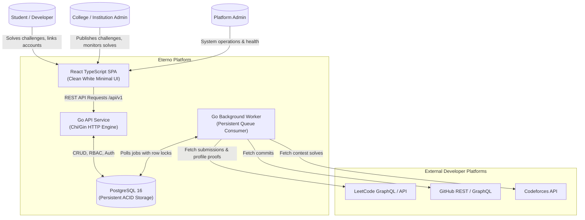
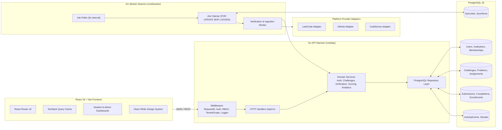
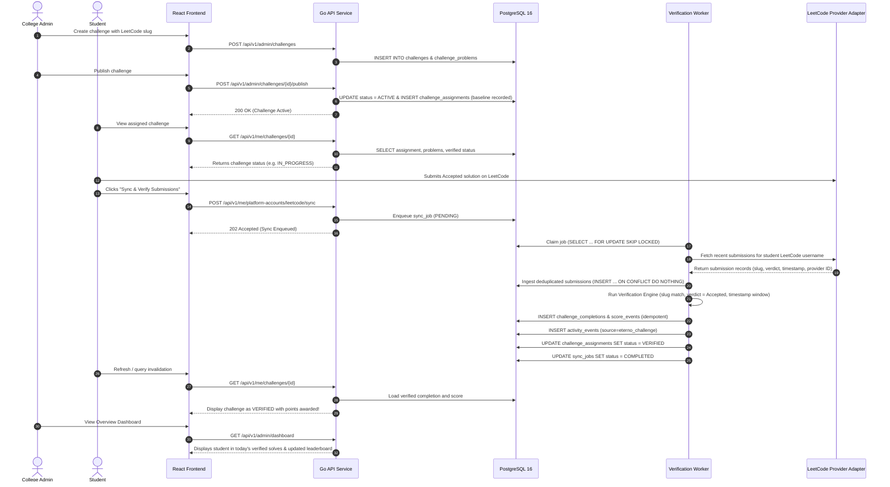
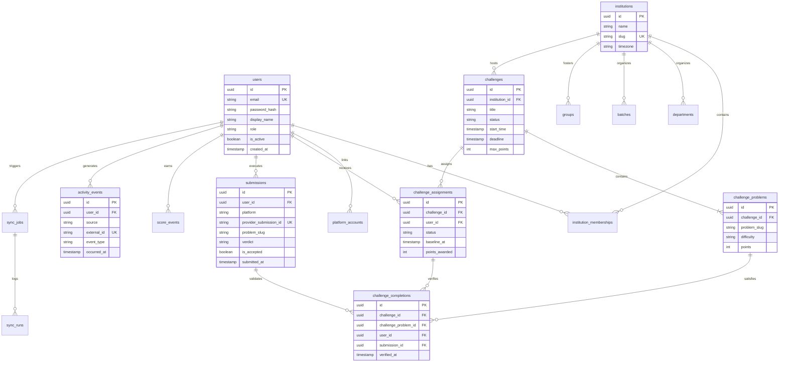
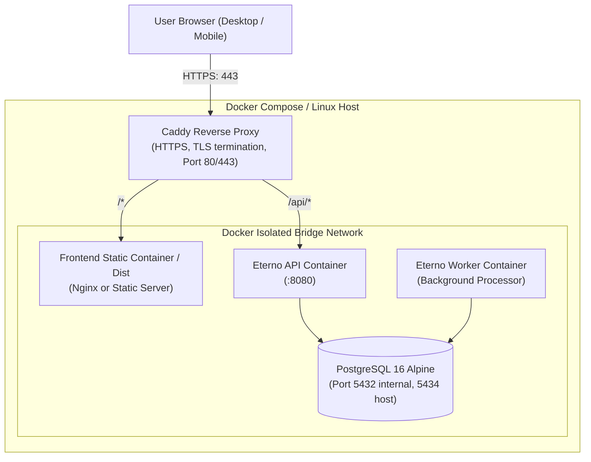

# Eterno Architecture Graph

This document details the architectural topology of the Eterno platform using Mermaid diagrams.

## 1. System Context Diagram

## 2. Runtime Architecture

## 3. Challenge Verification Sequence Diagram

## 4. Entity Relationship Diagram

## 5. Deployment Architecture

