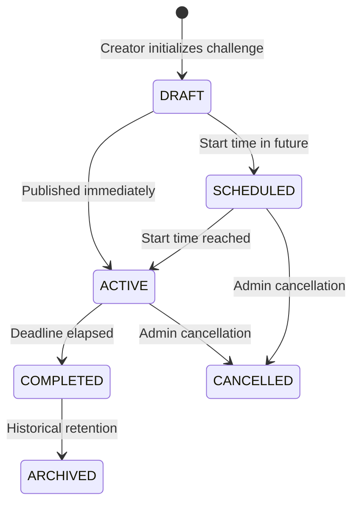

# Challenge Lifecycle & Assignment Policy

## Lifecycle State Machine

## Status Definitions
- `DRAFT`: Editable by creator, not visible to students, problems can be added/removed.
- `SCHEDULED`: Scheduled for automated publication at `start_time`.
- `ACTIVE`: Visible to students, student `challenge_assignments` generated, submission sync active.
- `COMPLETED`: Challenge deadline reached, scores finalized.
- `CANCELLED`: Withdrawn by admin; historical records preserved.
- `ARCHIVED`: Retained for audit and longitudinal reporting.

## Assignment Policies
- `baseline_at`: Defaults to challenge activation timestamp or assignment creation timestamp. Submissions made before this timestamp are rejected unless `historical_allowed` is true.
- `deadline`: Submissions with `submitted_at` > `deadline` are marked late and do not qualify for challenge completion or points.
